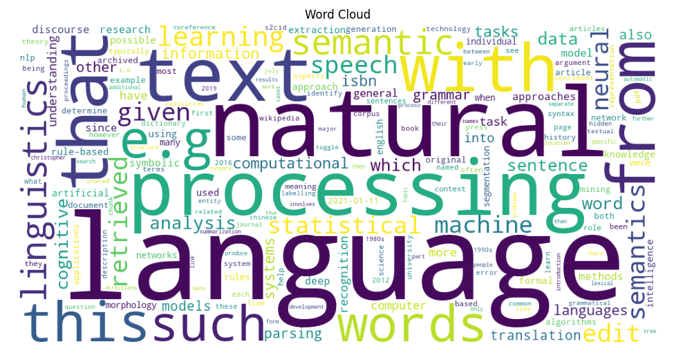

# NLP 02 - Job Description Text Preprocessing

[](pyproject.toml)
[](https://github.com/BethSpornitz/nlp-02-text-preprocessing-custom/actions/workflows/ci-python-zensical.yml)
[](https://bethspornitz.github.io/nlp-02-text-preprocessing-custom/)

[](https://docs.astral.sh/uv/)
[](https://docs.astral.sh/ty/)
[](https://zensical.org/)
[](LICENSE)

> Analyze data analysis job descriptions using Python text preprocessing to identify commonly requested skills and qualifications.

## Project Overview

Author: Beth Spornitz

Date: 2026 October

Second project in the Web Mining and Applied NLP course.

The project applies text preprocessing techniques to job descriptions for Data Analyst, Business Analyst, and Data Governance positions.

The goal is to identify frequently requested skills and qualifications while exploring how cleaning decisions affect the results.

The project is configured in
[pyproject.toml](pyproject.toml).

## Data

The project will use at least 10 publicly available job descriptions gathered from job postings.

The descriptions will be saved in a text file.

The analysis will focus on job responsibilities, required qualifications, and technical skills.


## Approach

The project will use Python to prepare and analyze job descriptions for Data Analyst, Business Analyst, and Data Governance positions.

The analysis will include:

- Reading job descriptions from a local text file.
- Tokenizing text into individual words.
- Converting text to lowercase.
- Removing punctuation and special characters.
- Filtering common stopwords.
- Comparing token counts before and after preprocessing.
- Calculating word frequencies using Polars.
- Visualizing frequently occurring terms using Matplotlib.
- Investigating whether preprocessing removes meaningful technical terms such as AI, BI, SQL, or R.

The goal is to understand how preprocessing choices affect the identification of commonly requested skills and qualifications in data-related jobs.

### Project Components

Explore these important project components:

- [pyproject.toml](pyproject.toml) - Project identity, dependencies, and tool configuration.
- [data/](data/) - Input text data, including job descriptions.
- [src/nlp/text_preprocessing.py](src/nlp/text_preprocessing.py) - Executable Python preprocessing analysis.
- [notebooks/text_preprocessing.ipynb](notebooks/text_preprocessing.ipynb) - Interactive Jupyter notebook example.
- [tests/](tests/) - Automated tests.
- [.github/workflows/](.github/workflows/) - Automated testing and documentation deployment.
- [docs/](docs/) - Project documentation.
- [zensical.toml](zensical.toml) - Documentation configuration.

## Run the Project

Follow the [Professional Python Workflow Guide](https://denisecase.github.io/pro-analytics-02/)
to set up your machine and project environment.

From a VS Code terminal in the project root:

```shell
uv run python -m nlp.text_preprocessing
```

**Close each visualization window** after viewing
so the script can continue executing.

The Jupyter notebook provides an additional
interactive version of the analysis.

## Results

The example loads text records,
applies preprocessing operations,
and produces token frequency summaries.

The analysis displays:

- Raw and cleaned token counts.
- A comparison of preprocessing stages.
- The most frequent cleaned tokens.
- Visualizations of token frequencies and counts.

Successful execution produces:

```shell
========================
Pipeline executed successfully!
========================
```

A `project.log` file is created in the project root.

This confirms that the Python analysis executes
and the logging system works.

### Example Visualization



## Verification

Run the automated tests:

```shell
uv run python -m pytest
```

## Project Documentation

The [hosted documentation site](https://bethspornitz.github.io/nlp-02-text-preprocessing-custom/)
is published using Zensical and GitHub Pages.

The documentation site is used to present the project report,
covering such sections as data, methods, results, visualizations,
interpretation, and conclusions.

## CI/CD and GitHub Actions

This project includes continuous integration and continuous deployment (CI/CD)
to check project files and publish the docs.

GitHub Actions include:

- [CI: Python and Documentation Checks](https://github.com/BethSpornitz/nlp-02-text-preprocessing-custom/actions/workflows/ci-python-zensical.yml)
- [CD: Documentation Deployment](https://github.com/BethSpornitz/nlp-02-text-preprocessing-custom/actions/workflows/deploy-zensical.yml)

## Developer Reference

Follow the
[Professional Python Workflow Guide](https://denisecase.github.io/pro-analytics-02/)
for **detailed instructions and troubleshooting**.

### Initialize and Update the Python Environment

With the project open in VS Code, open a VS Code terminal.
Paste each command and hit Enter or Return after to run it.

```shell
uvx pup-clean --delete
uv self update
uv python pin 3.14
uv python install
uv lock --upgrade
uv sync
uv audit
```

### Set Up and Run Git Hooks

Set up and run the git hooks to perform
basic checks automatically before
any changes get pushed to GitHub.

In the VS Code terminal,
paste each command and hit Enter or Return after to run it.

```shell
uvx prek install --force
uvx prek update --freeze --cooldown-days 7

git add -A
uvx prek run --all-files
# repeat if changes were made
uvx prek run --all-files
```

### Run Common Chores

Run linters, formatters, type checks, tests, and
build the documentation.

```shell
uv run ruff check . --fix
uv run ruff format .

uv run ty check
uv run python -m pytest
uv run python -m zensical build
```

### Git add-commit-push to GitHub

After making useful changes, save your work to GitHub.

```shell
git add -A
git commit -m "describe your changes in quotes"
git push -u origin main
```

## Developer Notes

- Use the **UP ARROW** and **DOWN ARROW** in the terminal to scroll through past commands.
- Use `CTRL+f` to find (and replace) text within a file.

## Developer Tools

This project uses professional Python tools to support development,
testing, documentation, and code quality.

- [uv](https://docs.astral.sh/uv/) - Python environments and dependencies.
- [Ruff](https://docs.astral.sh/ruff/) - Python linting and formatting, configured in [.ruff.toml](.ruff.toml).
- [ty](https://docs.astral.sh/ty/) - Python type checking.
- [pytest](https://docs.pytest.org/) - automated Python testing, configured in [.pytest.toml](.pytest.toml).
- [prek](https://prek.j178.dev/) - Git hooks and automated checks, configured in [prek.toml](prek.toml).
- [Zensical](https://zensical.org/) - project documentation, configured in [zensical.toml](zensical.toml).

## Links

- [Hosted Documentation](https://bethspornitz.github.io/nlp-02-text-preprocessing-custom/)
- [Professional Python Workflow Guide](https://denisecase.github.io/pro-analytics-02/)
- [Citation](CITATION.cff)
- [License](LICENSE)
