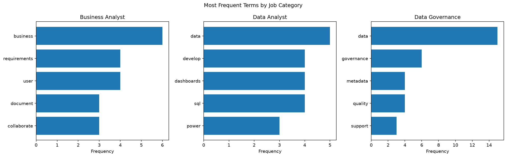

# Text Preprocessing and Job Description Analysis

**Beth Spornitz | October 2026**
**Web Mining and Applied NLP | Project 02**

## Overview

This project explores how text preprocessing techniques can be used to clean and analyze unstructured text. I first modified the original text preprocessing example to examine how changing stop words affected the results. I then created a custom application comparing terminology used in Data Analyst, Business Analyst, and Data Governance job postings.

## Data

The original example uses `data/text_data.txt`, which contains five short text records.

For my custom application, I created `data/job_descriptions.csv`, containing 12 short, paraphrased summaries of job postings. The dataset includes four summaries for each of three categories:

- Data Analyst
- Business Analyst
- Data Governance

Each record contains the job category, title, employer, source URL, and summarized description.

## Techniques Applied

I used Python and several text preprocessing techniques:

- Lowercasing text to standardize capitalization.
- Removing punctuation using regular expressions.
- Tokenizing text into individual words.
- Removing common stop words.
- Counting word frequencies.
- Visualizing results with Matplotlib.

I also used Polars to read and organize the CSV dataset.

## Custom Modifications

### Part 1: Modifying the Original Example

I modified the original preprocessing script by adding `text` and `language` to the stop-word list.

This allowed me to see how removing frequently occurring words affected the cleaned text.

The original preprocessing produced 46 cleaned tokens. After my modification, the count decreased to 38 tokens, a reduction of approximately 17.4%.

### Part 2: Job Description Analysis

I created a new Jupyter notebook, `job_description_analysis.ipynb`, to analyze terminology in three data related career paths.

I wrote a preprocessing function, grouped descriptions by job category, calculated word frequencies, and created comparison charts.

## Methods and Settings

The job description analysis combined the four summaries within each category before preprocessing.

The preprocessing function converted text to lowercase, removed punctuation, split text into words, and filtered common stop words.

Short technical terms such as AI and BI were retained because they can be meaningful in data related job descriptions.

The analysis calculated the ten most frequent words in each category and visualized the top five.

## Verification

I verified that the CSV dataset contained 12 records, with four descriptions in each job category.

I successfully executed the preprocessing and visualization notebook and confirmed that all three charts displayed.

I also resolved a Ruff D103 linting error by adding a docstring to the preprocessing function and rerunning the checks.

## Results

| Job Category | Cleaned Tokens | Five Most Frequent Terms |
|---|---:|---|
| Business Analyst | 85 | business (6), requirements (4), user (4), document (3), collaborate (3) |
| Data Analyst | 92 | data (5), develop (4), dashboards (4), sql (4), power (3) |
| Data Governance | 88 | data (15), governance (6), metadata (4), quality (4), support (3) |

### Visualization

## Observations

The three job categories showed different patterns in word frequency.

Business Analyst summaries frequently included requirements, user, and stakeholders.

Data Analyst summaries frequently included dashboards, SQL, Python, and reporting.

Data Governance summaries frequently included governance, metadata, and quality.

## Interpretation and Insights

The results suggest that Business Analyst positions use requirements for gathering and collaboration, while Data Analyst positions focus more heavily on technical analysis and reporting.

Data Governance positions emphasize data management, policies, and documentation.

I found it interesting that the differences among the three career paths were visible even in a small dataset.

The project also showed how preprocessing decisions can influence word frequency results.

## Limitations

The analysis used only 12 short, paraphrased job posting summaries rather than complete job descriptions.

The summaries were collected as a small convenience sample, so the results should not be interpreted as representative of the entire job market.

Word frequency analysis also does not capture the full meaning or context of job requirements.

## Next Steps

Future work could include collecting a larger dataset, analyzing complete job descriptions, identifying specific technical skills, and comparing job requirements over time.

## Project Notebooks

- [Original Preprocessing Modification](https://github.com/BethSpornitz/nlp-02-text-preprocessing-custom/blob/main/notebooks/text_preprocessing_modification.ipynb)
- [Custom Job Description Analysis](https://github.com/BethSpornitz/nlp-02-text-preprocessing-custom/blob/main/notebooks/job_description_analysis.ipynb)

## Documentation Index

- [Home](index.md)
- [Project Instructions](project-instructions.md)
- [Glossary](glossary.md)

## Project Links

- [My GitHub Repository](https://github.com/BethSpornitz/nlp-02-text-preprocessing-custom)
- [Original Example Repository](https://github.com/denisecase/nlp-02-text-preprocessing)
- [Custom Job Description Dataset](https://github.com/BethSpornitz/nlp-02-text-preprocessing-custom/blob/main/data/job_descriptions.csv)
- [Professional Python Guide](https://denisecase.github.io/pro-analytics-02/)
